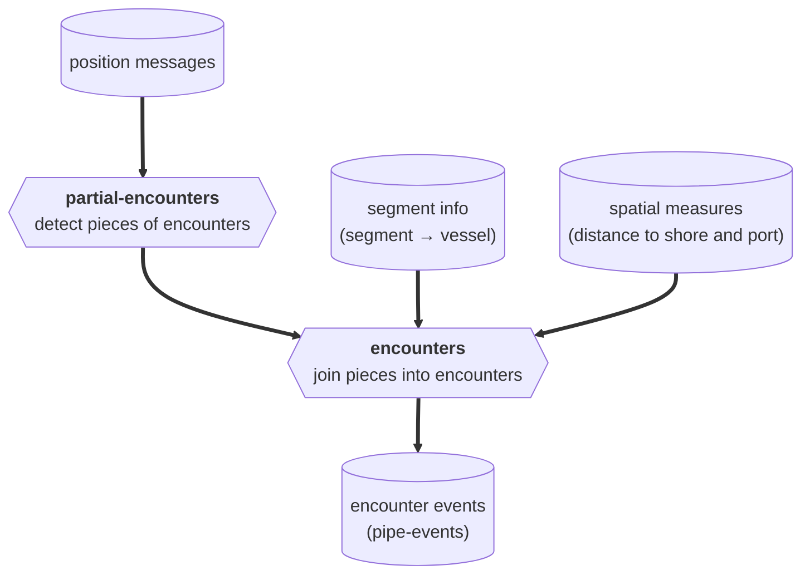

<h1 align="center" style="border-bottom: none;"> pipe-encounters </h1>

<p align="center">
  <a href="https://codecov.io/gh/GlobalFishingWatch/pipe-encounters">
    
  </a>
  <a>
    
  </a>
  <a>
    
  </a>
  <a>
    
  </a>
</p>

Detects encounters between vessels at sea:
two vessels that stay close to each other for hours, away from port --
from vessel position data, AIS or VMS.

[contributing guide]: https://github.com/GlobalFishingWatch/python-app-template/blob/main/CONTRIBUTING.md
[preparing the development environment]: https://github.com/GlobalFishingWatch/python-app-template/blob/main/CONTRIBUTING.md#preparing-the-development-environment
[git workflow]: https://github.com/GlobalFishingWatch/python-app-template/blob/main/CONTRIBUTING.md#git-workflow
[python-app-template]: https://github.com/GlobalFishingWatch/python-app-template
[gfw-common]: https://github.com/GlobalFishingWatch/gfw-common
[pipe-events]: https://github.com/GlobalFishingWatch/pipe-events
[pipe-segment]: https://github.com/GlobalFishingWatch/pipe-segment
[Makefile]: Makefile

**Table of contents**:
- [Introduction](#introduction)
- [How it works](#how-it-works)
- [Known issues](#known-issues)
- [Development](#development)
- [Usage](#usage) * [Using the CLI](#using-the-cli) * [Config files](#config-files)
- [References](#references)

## Introduction

<div align="justify">

Global Fishing Watch processes billions of AIS position messages
to track vessel activity at sea. [[1]](#1)
Some of the most relevant of that activity involves two vessels, not one:
a fishing vessel meeting a refrigerated cargo vessel to transfer its catch (transshipment),
or a bunker vessel refueling a fishing fleet far from port.
Transshipment at sea can be legitimate,
but it can also be used to hide where fish was caught,
which makes these meetings a key input to monitoring and risk analysis. [[2]](#2)

`pipe-encounters` detects those meetings.
Global Fishing Watch defines an *encounter* as two vessels within 500 meters of each other
for at least 2 hours, at a median speed of less than 2 knots,
and at least 10 km from a coastal anchorage. [[2]](#2) [[3]](#3)
Positions are estimated on a 10-minute grid,
and encounters between the same two vessels less than 4 hours apart
are consolidated into one. [[3]](#3)

This repository detects the vessel pairs that stay close together for long enough, away from port,
and joins them into encounters.
The published encounter events are built from its output by [pipe-events],
which also applies the median speed condition and adds region and vessel information.

Both commands run in production *daily*, against both AIS and VMS vessel tracks.

</div>

## How it works

<div align="justify">

The pipeline is a chain of two stages, each its own CLI command (see [Usage](#usage)):

</div>



<div align="justify">

- **`partial-encounters`** processes the position messages of each track segment
  (a piece of a vessel's track, as split by [pipe-segment]), one UTC day at a time.
  It resamples each segment-day onto a 10-minute grid,
  interpolating across gaps between positions shorter than `max-gap-seconds` (1 hour by default),
  and extrapolating up to `max-gap-seconds` before the first and after the last position,
  within the day.
  At each 10-minute step, it finds the other segments within `max-encounter-dist-km`,
  and keeps every unbroken run next to the same segment
  that lasts at least `min-encounter-time-minutes`.
  Each output row is a *piece* of an encounter, not a whole one:
  an encounter that crosses midnight is split into one piece per day,
  each piece appears twice, once from each segment's side,
  and pieces are identified by segment, not by vessel.
  The rows of the processed dates are appended to the output table,
  after deleting the dates' existing rows.
- **`encounters`** maps each partial encounter's segments to vessel ids,
  drops the ones within 10 km of a port, or without a positive distance from shore,
  and joins the pieces of the same two vessels while they are less than
  `min-hours-between-encounters` (4 hours by default) apart:
  across days, segments, and both vessels' sides.
  Each output row is one encounter between two vessels.
  The output table is replaced on every run, so it's run over the whole history.

</div>

## Known issues

<div align="justify">

The current output has some known issues, to be fixed in the pipeline itself:

- A piece of an encounter shorter than `min-encounter-time-minutes` on its own day is dropped
  by `partial-encounters`, so `encounters` can't join it to the rest of the encounter:
  an encounter from 23:00 to 02:00 loses the hour before midnight.
- The extrapolated positions before the first and after the last position of a segment-day
  can extend an encounter up to `max-gap-seconds` beyond the positions that support it,
  and they're computed with the course converted to radians twice, so they head the wrong way.
- `encounters` adds up the point counts of both sides of each piece,
  so the vessels' point counts are doubled.
- `partial-encounters` deletes the processed dates by the start of each piece,
  but writes the pieces by their end,
  so reprocessing dates can duplicate the pieces that start the day before.

</div>

## Development

<div align="justify">

First, clone the repository:

</div>

```shell
git clone https://github.com/GlobalFishingWatch/pipe-encounters.git
cd pipe-encounters
```

<div align="justify">

Then, from the cloned repository, follow the [contributing guide]
shared by the repositories created from [python-app-template]:
[preparing the development environment] (Docker setup, installing dependencies, pre-commit hooks)
and the [git workflow].

This repository's CLI and Apache Beam pipeline infrastructure are built on [gfw-common].

Once your environment is set up, the [Makefile] in this repository exposes the usual targets:
`make docker-build`, `make docker-shell`, `make test`, `make format`, `make lint`, among others --
run `make help` for the full list.
No repository-specific system dependency is required.

</div>

## Usage

### Using the CLI

<div align="justify">

`pipe-encounters`'s CLI covers both stages of the pipeline.
Run `pipe-encounters -h` for the authoritative, up-to-date list,
or `pipe-encounters <command> -h` for a command's own parameters.

</div>

<table>
<tr>
<th width="1%" nowrap>Command</th>
<th>Description</th>
</tr>
<tr>
<td width="1%" nowrap><code>partial&#8209;encounters</code></td>
<td>Detects the pieces of encounters, per UTC day and pair of track segments,
and appends them to a table.</td>
</tr>
<tr>
<td width="1%" nowrap><code>encounters</code></td>
<td>Joins the partial encounters into one row per encounter between two vessels,
replacing a table.</td>
</tr>
</table>

<div align="justify">

Date ranges start at `--start-date` and end before `--end-date`.
`--bq-in-positions` and `--bq-in-segment-info` accept several tables,
each optionally prefixed by `ID::` to keep the segment ids of different sources (e.g. AIS and VMS) distinct.
Besides each command's own options, they accept any Apache Beam pipeline option,
like `--runner` or `--max-num-workers`.

Example:

</div>

```shell
pipe-encounters partial-encounters \
    --bq-in-positions world-fishing-827.pipe_production_v20201001.position_messages \
    --bq-out-partial-encounters world-fishing-827.scratch_tomas_ttl30d.raw_encounters \
    --start-date 2024-01-01 --end-date 2024-01-02 \
    --max-encounter-dist-km 0.5 --min-encounter-time-minutes 120 \
    --labels environment=development resource_creator=tomas-link project=ais stage=encounters
```

### Config files

<div align="justify">

Besides plain CLI flags,
every command also accepts a config file via the built-in `-c`/`--config-file` flag (YAML or JSON),
with CLI flags taking precedence over matching config-file keys.
A runnable example for each command lives under `config/<command-name>/`,
e.g. [config/partial-encounters/bq-1-day.yaml](config/partial-encounters/bq-1-day.yaml) --
use these as a starting point rather than hand-writing one from scratch.

</div>

```shell
pipe-encounters partial-encounters -c config/partial-encounters/bq-1-day.yaml
pipe-encounters encounters -c config/encounters/bq-full-history.yaml
```

## References

<a id="1">[1]</a> Kroodsma, D. A., Mayorga, J., Hochberg, T., Miller, N. A., Boerder, K., Ferretti,
F., Wilson, A., Bergman, B., White, T. D., Block, B. A., Woods, P., Sullivan, B., Costello, C. J.,
Worm, B. (2018). Tracking the global footprint of fisheries. Science, 359(6378), 904-908.
https://doi.org/10.1126/science.aao5646

<a id="2">[2]</a> Miller, N. A., Roan, A., Hochberg, T., Amos, J., Kroodsma, D. A. (2018).
Identifying Global Patterns of Transshipment Behavior. Frontiers in Marine Science, 5, 240.
https://doi.org/10.3389/fmars.2018.00240

<a id="3">[3]</a> Global Fishing Watch. What is a vessel encounter? (FAQ).
https://globalfishingwatch.org/faqs/what-is-a-vessel-encounter/

# License

Copyright 2017 Global Fishing Watch

Licensed under the Apache License, Version 2.0 (the "License");
you may not use this file except in compliance with the License.
You may obtain a copy of the License at

    http://www.apache.org/licenses/LICENSE-2.0

Unless required by applicable law or agreed to in writing, software
distributed under the License is distributed on an "AS IS" BASIS,
WITHOUT WARRANTIES OR CONDITIONS OF ANY KIND, either express or implied.
See the License for the specific language governing permissions and
limitations under the License.
